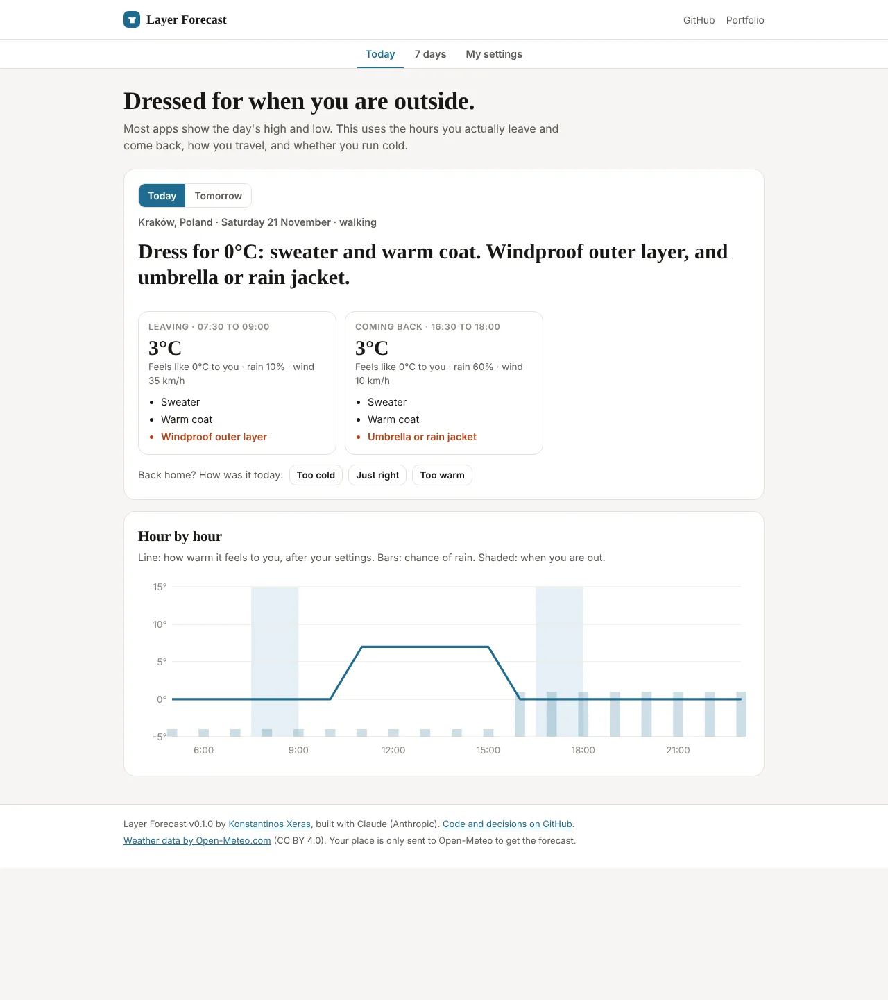

# Layer Forecast

**The forecast for when you are actually outside, turned into layers. It learns whether you run cold or warm from one tap a day.**

**Current version:** 0.1.0

Live app: https://kostasxeras.com/layer-forecast/



## Why this exists

Weather apps show the day's high and low. Nobody is outside at the high. People are outside on the way to work and on the way back, and they feel the cold differently. This app looks only at the hours you are out, adjusts for how you travel, and learns your comfort from one tap a day.

## Who it is for

- People who walk, cycle or take public transport to work
- Parents dressing children for the school run
- Anyone who is always too cold or too warm by the evening

## What it does

- **Your hours:** set when you leave and come back, and whether you go out at midday. Advice uses the coldest hour of each window.
- **How you travel:** walking or public transport, bike or scooter (feels about 2°C colder, stricter rain line, gloves below 8°C), or car (2°C kinder).
- **Comfort learning:** "I usually run cold or warm", plus a daily "too cold, just right, too warm" tap. Each answer moves the advice by half a degree, up to 5°.
- **Today and tomorrow:** a one-line headline, then a card per window with temperature, feels like, rain, wind, layers, rain and wind extras, UV tips and snow boots.
- **Hour by hour:** a chart of how warm it feels to you, the chance of rain, and your hours out shaded.
- **7 days:** the coldest daytime feel, the warmest, rain, and what to wear each day.
- **Places and units:** up to 6 saved places, search or use your location, °C and km/h or °F and mph. All rules are listed in the app.

## Privacy

Everything is stored in your browser's local storage. There is no account and no server of mine. The forecast and place search call Open-Meteo directly from your browser. Clearing your browser data deletes it.

## Decisions

- [Advise on the coldest hour you are out, not the day's range](docs/decisions/0001-coldest-hour-you-are-out.md)
- [Learn comfort from one tap, with a simple rule](docs/decisions/0002-simple-learning-from-one-tap.md)
- [Use Open-Meteo directly from the browser](docs/decisions/0003-open-meteo-no-backend.md)

## How I would measure success

No usage data yet. These are the measures I would track, with targets to set after a first month of use.

| Measure | Definition | Target |
|---|---|---|
| Comfort | Share of daily answers that are "just right" after 2 weeks of use | [x]% |
| Return use | Share of users who open it on at least 4 mornings a week | [x]% |
| Learning | Days until answers settle on "just right" | [x] days |

## What I would do next

1. Learn comfort separately for mornings and evenings
2. A morning notification with the headline
3. Children's profiles with their own comfort setting

## How it was built

I defined the problem, the users, the features and the decisions. Claude (Anthropic) was my engineering partner for the code. The idea started from a small example in Ziplines' list of vibe coding projects, which I turned into a full app with my own product choices.

Weather data comes from [Open-Meteo](https://open-meteo.com/) (CC BY 4.0). The screenshots were taken with a test forecast, not live weather.

## Run it yourself

It is one HTML page and one stylesheet, with no build step. Open `index.html` through any local web server, for example `python3 -m http.server`, then go to http://localhost:8000.

## Repo layout

```
index.html               The app
app.css                  Shared base styles
docs/product-brief.md    Problem, users, goals, scope
docs/case-study.md       Approach, decisions, what to measure, next steps
docs/decisions/          One record per real tradeoff
docs/screenshots/        Desktop and mobile
```
